# Install & User Guide

## 1. Install

1. Download `KrakenCCCharWizard.ext` from the latest [Release](../../releases/latest).
2. Copy it into the `extensions` folder of your Fantasy Grounds data folder, usually `%appdata%\SmiteWorks\Fantasy Grounds\extensions`.
3. Start FGU and select (or create) a **Castles & Crusades** campaign. Click **Extensions** and tick **C&C Character Creation Wizard**, then start the campaign.
4. In **Library → Modules**, load the **Castles & Crusades Players Handbook**. Load any other C&C books you want the wizard to use as well: their classes and races join the Race and Class pages (the Adventurer's Backpack adds 17 classes), their gear joins the shop and their spells join the spell lists.

Players don't install anything. They get the extension from the host when they connect.

## 2. Open the wizard

Open **Characters**. The wizard icon sits in the top-left corner of the Character Selection window, and it's there for the Castle Keeper and for players.

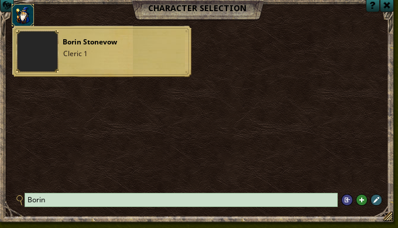

## 3. Castle Keeper options

**Options → Character Wizard** sets the rules for the table:

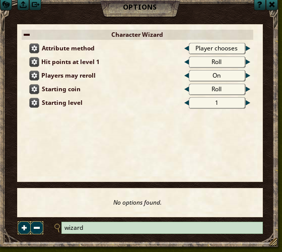

| Option | Choices |
|---|---|
| Attribute method | Player chooses, 3d6 arrange, 4d6 drop lowest, 3d6 in order |
| Hit points at level 1 | Roll, Maximum |
| Players may reroll | On, Off (the Castle Keeper can always reroll) |
| Starting coin | Roll, Maximum, Double |
| Starting level | 1 to 24 |

## 4. The tabs

A ✔ on a tab means it's done, and a **!** means something there still needs a choice. You can move between tabs in any order. Each tab's **Instructions** panel explains the step and can be collapsed.

### Abilities
Choose a method (unless the Castle Keeper has set one) and click **Roll All**. Every roll shows in chat. Drag one Base score onto another to swap them (not with 3d6 in order). Your race's adjustments fill in once you pick a race.

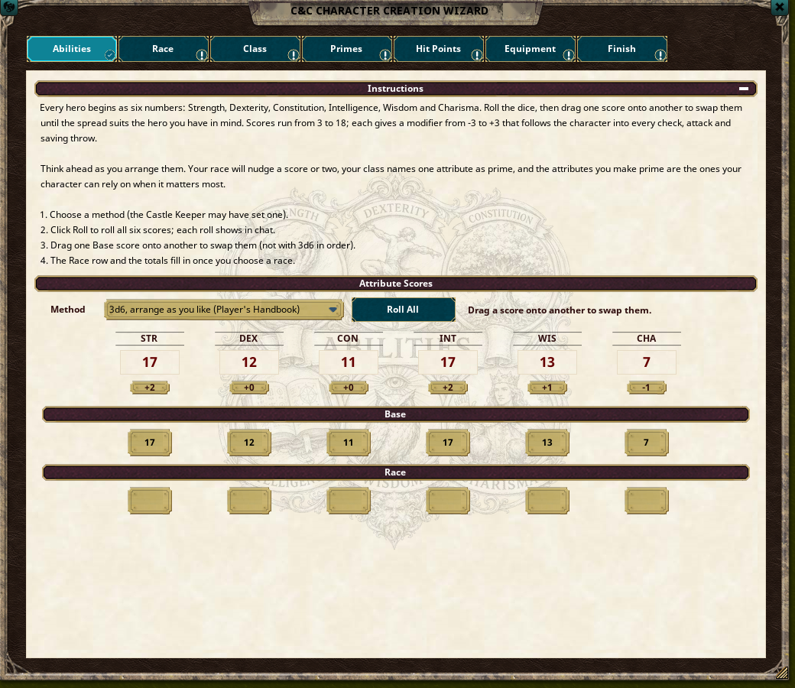

### Race
Click a race's name to read it, and click **+** to choose it. The tab shows its attribute modifiers, move, extra primes, languages and every trait. **Change Race** takes you back to the list.

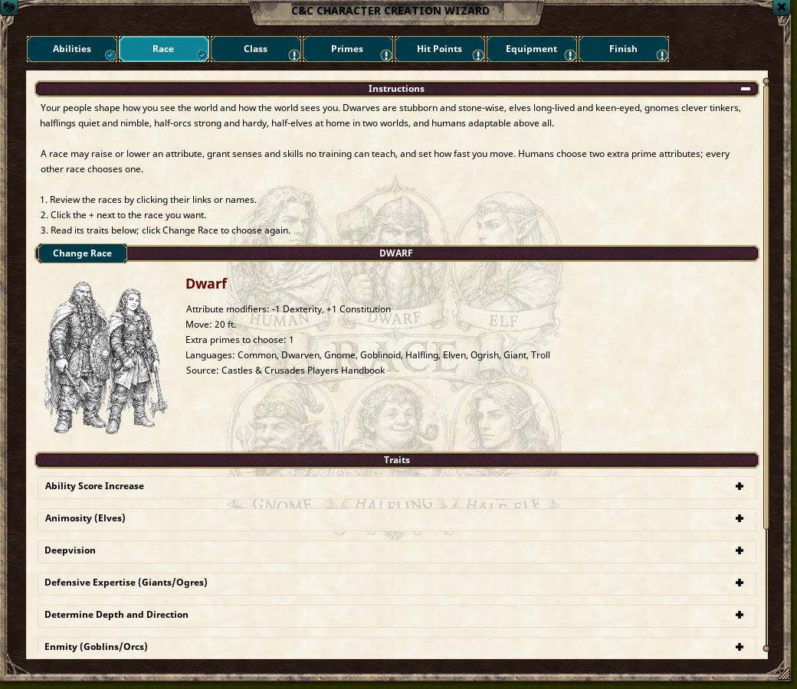

### Class
Your race decides which classes you can take. The class card shows the prime, hit die, base to hit, hit dice at your level and starting coin, and below it the class abilities you have at your level. Under **Combine Classes (Adventurer's Backpack)** you can start with more than one class if your Castle Keeper allows it.

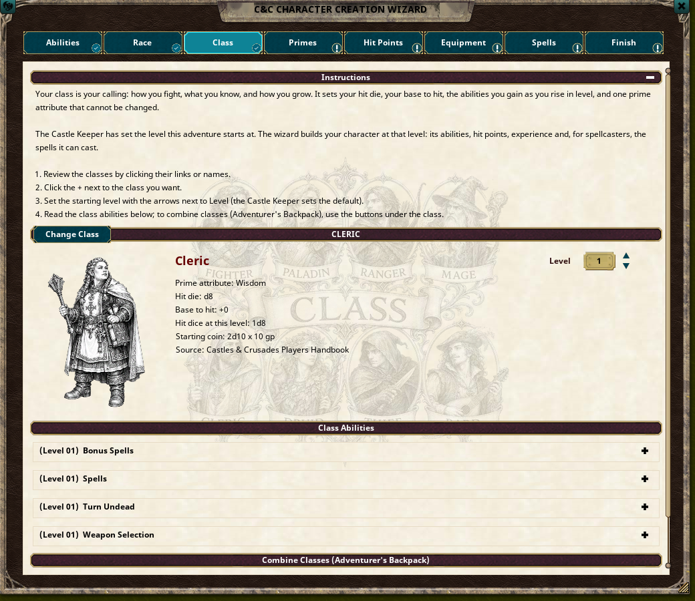

### Primes
Your class's prime is ticked already. Tick the others your race allows: humans get two more, every other race gets one.

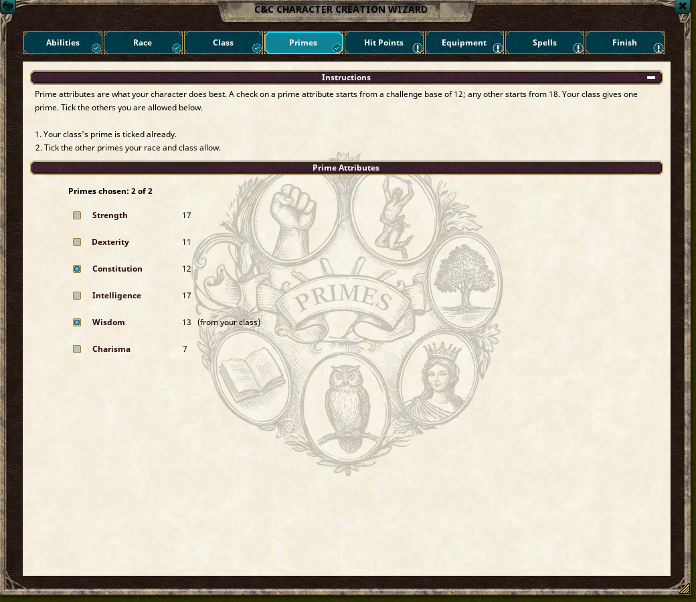

### Hit Points
**Roll Hit Points** rolls once for each level: the class's hit die plus your Constitution modifier.

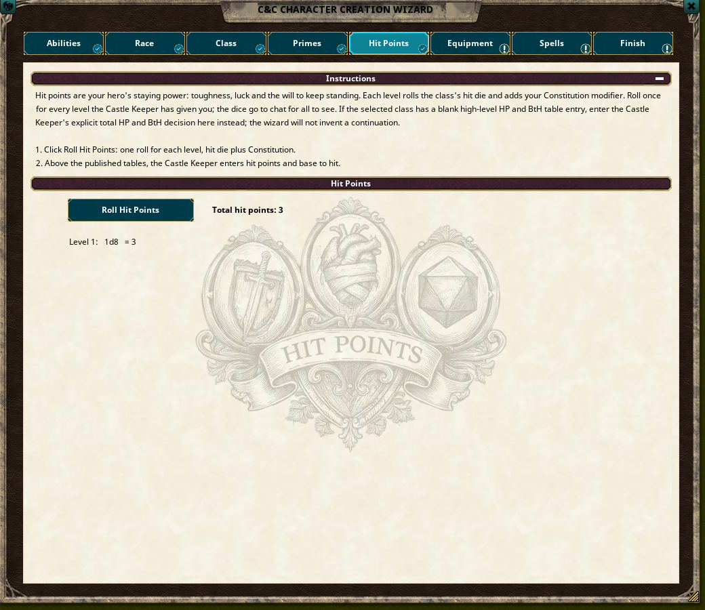

### Equipment
1. **Roll Starting Coin.** The amount comes from your class.
2. Buy from the shop. Choose a type (Everything, Armor, Weapons, Gear and so on) or search by name. The shop lists only gear your class can use and only what your coin still covers.
3. **Return** gives an item back.

Armor you buy is worn when the character is made, and weapons appear ready on the Combat tab. Unspent coin goes into your purse.

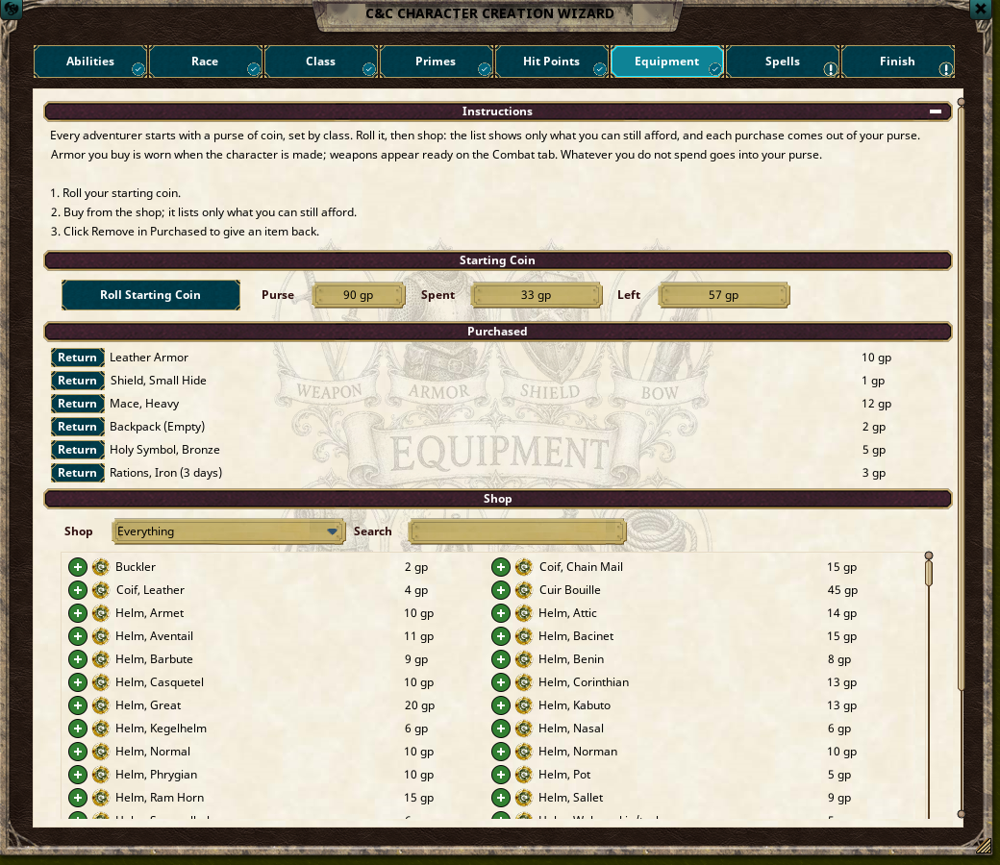

### Spells
For spellcasters only. The header shows your spells per day at your starting level. Tick one spell for each one you can cast per day, and use Search and Level to narrow the list. Double-click a spell's name to read it.

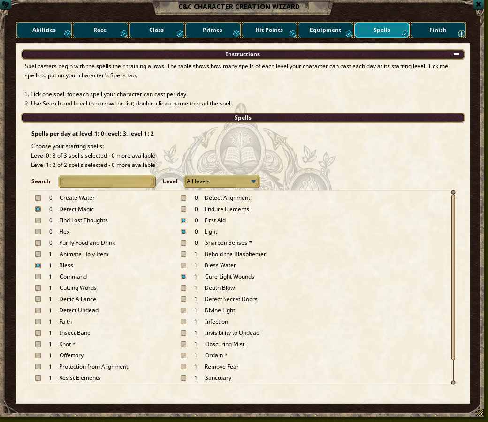

### Finish
Enter a name, alignment and any other details, check the summary, then click **Create Character**. The wizard makes the sheet with the ruleset's own race and class loaders, adds your gear and spells, and opens the sheet.

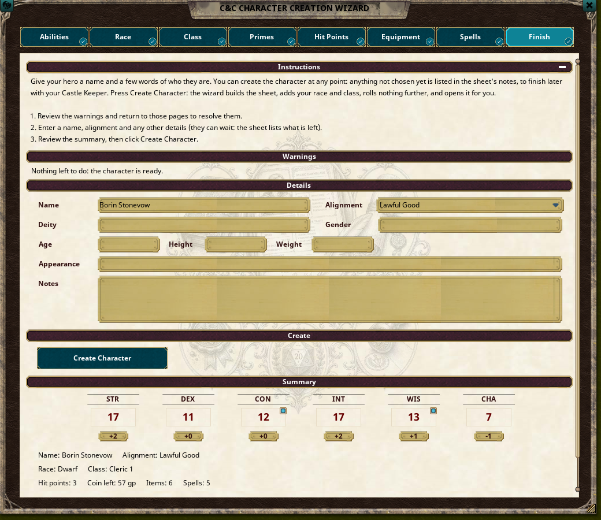

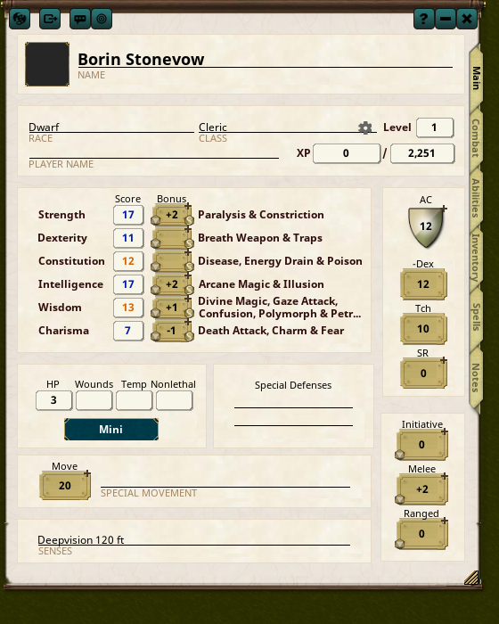

**Not finished? Save anyway.** **Create Character** works at any point. Whatever you haven't chosen yet is listed at the top of the sheet's **Notes**, so you can finish it with your Castle Keeper. A character without a name is saved as "Unnamed character".

## 5. Level up

On the character sheet's Main tab, the cog beside the level opens **Class & Level**. **Lvl Up** opens the Level Up window:

- **Class:** the class that gains the level. Add Class (dual class) and Reclass from the Adventurer's Backpack are here too.
- **Hit Points:** roll the new level's hit points.
- **Spells:** pick the new spells for each class that gains them.
- **Finish:** warnings, a summary, and **Level Up**.

Nothing changes on the sheet until you click **Level Up** on Finish.

## 6. Troubleshooting

- **No races, classes or spells:** load the Castles & Crusades Players Handbook module (Library → Modules).
- **The shop is short:** it shows only what your class may use and what your coin covers. Roll your coin first.
- **A player's character doesn't appear:** the host's Characters list shows every character. Ask the Castle Keeper to check that the player owns it.
